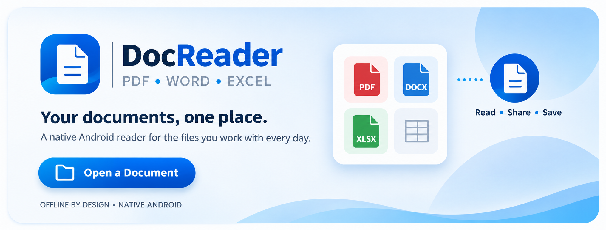
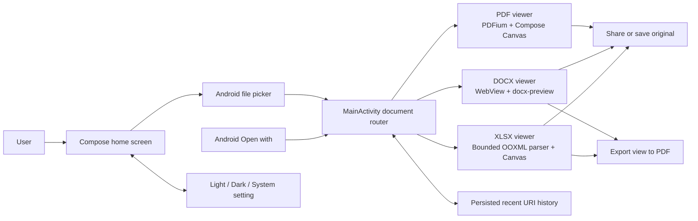

# DocReader



**DocReader** is an offline native Android app for opening and reading PDF, Word
(`.docx`), and Excel (`.xlsx`) documents. It uses Jetpack Compose for the app UI,
Android's Storage Access Framework for document access, and format-specific
viewers for rendering.

> The image above is branding artwork, not an in-app screenshot. The app
> does not currently include a captured emulator screenshot in this repository.

## Features

| Format | Viewer | Available actions |
| --- | --- | --- |
| PDF | PDFium, continuous vertical pages, fit-to-width startup, pinch zoom, page counter, and password prompt for encrypted files | Share, save the original file |
| DOCX | WebView with the bundled `docx-preview` renderer, document formatting, and embedded image support | Share, export the rendered document to PDF, save the original file |
| XLSX | Bounded OOXML parser, sheet tabs, formatted grid, merged cells, frozen panes, and saved formula values | Share, export the rendered sheets to PDF, save the original file |

Other app features:

- Open files from the Android system picker or from another app's **Open with** flow.
- Reopen recent documents using persisted URI access grants, with recovery when a
  file is moved, deleted, or its access is revoked.
- Choose **Light**, **Dark**, or **System Default** appearance; the selection is
  saved across app restarts.
- Use Android's **Save As** picker to download the original PDF, DOCX, or XLSX
  bytes without converting the document.
- Export DOCX and XLSX views to PDF. Exported layout follows DocReader's renderer
  and may differ from Microsoft Word or Excel.
- Use the blue-and-white adaptive launcher icon, including a monochrome layer for
  supported themed icons.

DocReader supports `.xlsx`, not legacy `.xls`. It does not request broad storage
or network permissions.

## How the app is organized



### Main source areas

| Path | Responsibility |
| --- | --- |
| `app/src/main/java/com/underrated/docreader/MainActivity.kt` | SAF and Open with entry points, routing, and document lifecycle |
| `app/src/main/java/com/underrated/docreader/ui/OpenScreen.kt`, `RecentDocuments.kt`, `Theme.kt` | Home screen, recent files, and persisted appearance setting |
| `app/src/main/java/com/underrated/docreader/ui/ViewerScreen.kt`, `app/src/main/java/com/underrated/docreader/viewer/` | PDF viewer UI, page layout, gestures, and render scheduling |
| `app/src/main/java/com/underrated/docreader/pdf/` | PDFium and Android `PdfRenderer` implementations |
| `app/src/main/java/com/underrated/docreader/docx/`, `app/src/main/assets/docx/` | DOCX WebView bridge and bundled preview scripts |
| `app/src/main/java/com/underrated/docreader/xlsx/` | XLSX parser, canvas grid, formatting, and PDF output |
| `app/src/main/java/com/underrated/docreader/export/DocumentExport.kt` | Sharing, original-file Save As, and export pipeline |

The DOCX preview libraries are bundled in the app and loaded locally; document
rendering does not fetch scripts or other resources from the network.

## Build

### Requirements

The checked-in Gradle wrapper and Android plugin use this project configuration:

| Tool | Version |
| --- | --- |
| JDK | 21 |
| Gradle wrapper | 9.9.1 |
| Android Gradle Plugin | 9.5.1 |
| Kotlin | 2.4.21 |
| Android compile SDK | 37 |
| Android build tools | 36.0.0 |
| Minimum Android version | API 24 |
| Target Android version | API 36 |

Install the required Android SDK platforms and build tools. Set `sdk.dir` in a
local `local.properties` file; this machine-specific file is ignored by Git.

### Build and checks

Windows PowerShell:

```powershell
.\gradlew.bat :app:assembleDebug :app:lintDebug :app:testDebugUnitTest
```

macOS or Linux:

```bash
./gradlew :app:assembleDebug :app:lintDebug :app:testDebugUnitTest
```

Per-ABI and universal debug APKs are written to
`app/build/outputs/apk/debug/`. The ARM64 APK is
`app/build/outputs/apk/debug/app-arm64-v8a-debug.apk`.

There are currently no unit or instrumentation test sources in the project, so
the unit-test task reports `NO-SOURCE` until tests are added.

## Rendering notes and limitations

- PDFium is the default PDF engine. Double-tap zoom is disabled; pinch zoom is
  available. Password entry is supported by PDFium for encrypted PDFs.
- DOCX pagination is produced by `docx-preview` and can differ from Microsoft
  Word. Some advanced Word features, including text boxes, SmartArt, tracked
  changes, footnotes, comments, embedded fonts, and vertical table cell merges,
  may be missing or rendered differently.
- XLSX formulas are not recalculated; the workbook's saved cached values are
  displayed. Charts, pivot tables, images, macros, external links, data
  validation, and conditional formatting are not rendered.
- XLSX parsing has bounds for input size, expanded ZIP content, rows, columns,
  cells, sheets, and XML-backed collections to limit resource use. Current
  limits include a 100 MB input, 256 MiB total expanded ZIP content, 64 MiB per
  ZIP part, 20,000 archive entries, 100,000 rows, 512 columns, and 300,000
  populated cells per sheet.
- Exported PDFs reflect the content supported by DocReader's DOCX or XLSX
  renderer; they are not full-fidelity replacements for Office exports.
- The Android `PdfRenderer` implementation remains in source as an alternate
  backend; the app currently uses PDFium by default and has no engine selector.

## License and third-party components

The DOCX preview scripts are bundled under `app/src/main/assets/docx/`. Refer to
their accompanying license notices and upstream project terms when distributing
the app. The Android application source is provided in this repository; no
separate project license file is currently included.
